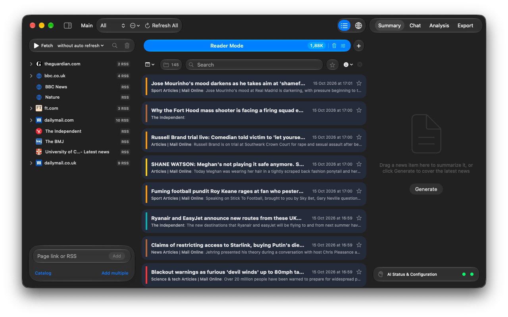

# InfoBubble
## News reader and AI filter for macOS, with a built-in database of news websites and podcasts
#### https://apps.apple.com/app/id6752404003 | macOS 26.0+

This is the support repository of InfoBubble, a partially free macOS app that collects news from RSS feeds
and websites, analyses every article on your Mac (tone, topics, places) and lets you read, search,
summarise, chat with or filter it with your own AI prompt.

The free version fetches up to 100 sources, with 3 tabs and 2 workspaces. The full version is a one-time
in-app purchase with Family Sharing.

## Documentation

**[InfoBubble Handbook](https://infobubble.github.io/infobubble-support/how-to.html)**: one short page per topic.

- [Getting started](https://infobubble.github.io/infobubble-support/handbook/getting-started.html)
- [Using the Sources Catalog](https://infobubble.github.io/infobubble-support/handbook/sources-catalog.html)
- [Choosing an AI](https://infobubble.github.io/infobubble-support/handbook/choosing-ai.html) and [Local AI with LM Studio](https://infobubble.github.io/infobubble-support/handbook/lm-studio.html)
- [Processing modes](https://infobubble.github.io/infobubble-support/handbook/processing-modes.html): AI, Machine Learning, Heuristics

The site's sources live in `docs/`; the handbook pages are generated by `python3 tools/build_handbook.py`.

## Sources database

The catalog of news websites and podcasts the app ships with:

- browse it: [News Websites Catalog](https://infobubble.github.io/infobubble-support/catalog.html)
- download it: [all.sources.rss.yaml](Sources/all.sources.rss.yaml)

It is not an "everything" database, and countries and categories are assigned automatically, so expect
some mistakes.

## Questions

Open an issue in this repository. See also the [Privacy Policy](Privacy.md).
